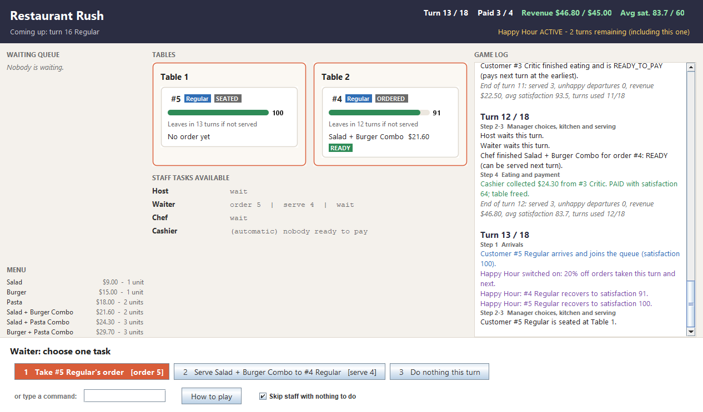

# Restaurant Rush

A turn-based restaurant management game for the command line, written in Java 17. No external libraries, works offline.

**Course:** SC2002 Object-Oriented Design & Programming  |  **Lab group:** SCE1  |  **Final version:** Stage 3

**Repository:**  [SC2002_OOP_Restaurant_Rush](https://github.com/SleepyBryan01/SC2002_OOP_Restaurant_Rush)

**Video Presentation Link:** https://youtu.be/ckfjWXzogrM 

| Members | Matriculation Number |
|---|---|
| Bryan Ng Chang Lin | U2520188B |
| Corbin Teo | U2522049K |
| Deng Lisiwei Julie | U2540735G |
| Poe Pyi Zaw | U2523900J |
| Subarna Premkumar | U2522299E |

## Contents

1. [Quick start](#quick-start)
2. [Stages](#stages)
3. [How to play](#how-to-play)
4. [Game rules](#game-rules)
5. [Object-oriented design](#object-oriented-design)
6. [Diagrams](#diagrams)
7. [Change evidence between stages](#change-evidence-between-stages)
8. [Optional window version](#optional-window-version)
9. [Submission evidence](#submission-evidence)


---

## Quick start

### IntelliJ IDEA

*File > Open* this folder, set the Project SDK to JDK 17 or later if asked, then run one of the configurations: **Play (terminal)**, **Play (window)** or **Replay_stageN_...**.

### Command line

Run from the project root.

```bash
# Compile (macOS / Linux)
javac --release 17 -d out $(find src -name "*.java")
```

```powershell
# Compile (Windows PowerShell)
javac --release 17 -d out (Get-ChildItem -Recurse src -Filter *.java).FullName
```

```bash
# Play in the terminal
java -cp out restaurantrush.Main

# Play in the optional window version (same game and rules)
java -cp out restaurantrush.Main --gui

# Replay a recorded run (commands are read from the file and echoed)
java -cp out restaurantrush.Main runs/stage3-victory.txt
```

<br>

<details>
<summary><b>Project structure</b></summary>

<br>
  
> ```text
> src/restaurantrush/
> ├── controller/   Game flow and turn management
> ├── model/        Customers, orders, menu, pricing
> ├── staff/        Waiter, Chef, Cashier, Host
> ├── view/         Console and Swing UI
> ├── enums/        Game states and commands
> ├── util/         Utilities
> └── Main.java
>
> docs/             diagrams, screenshots, report
> runs/             replay scripts for all stages
> ```

</details>

---

## Stages

Each stage is a single tagged commit, so any stage can be checked out and run on its own:

```bash
git checkout stage-2
```

| Tag | What it adds |
|---|---|
| `stage-1` | Basic operation: Regular customers, Waiter, Chef, automatic Cashier, 2 tables, 3 dishes, 18 turns |
| `stage-2` | VIP customer (turn 4) and Critic customer (turn 7) |
| `stage-3` | Host role, ComboMeal menu items, Happy Hour (**final version**) |
| `gui-extra` | Optional Swing window on top of Stage 3, with no rule changes |

<br>

<details>
<summary><b>Replay scripts and results</b></summary>

<br>

> Replay scripts only run at their own tag, because later stages add prompts (Host, Happy Hour).
>
> | Stage | Script | Result |
> |---|---|---|
> | 1 | `runs/stage1-victory.txt` | VICTORY: 5 paid, $66.00, avg 79.2 |
> | 1 | `runs/stage1-defeat.txt` | DEFEAT: 3 paid, $42.00, avg 38.7 |
> | 2 | `runs/stage2-victory.txt` | VICTORY: 5 paid, $64.50, avg 78.0 |
> | 2 | `runs/stage2-defeat.txt` | DEFEAT: 3 paid, $31.50, avg 86.0 |
> | 3 | `runs/stage3-victory.txt` | VICTORY: 5 paid, $87.84, avg 86.6 |
> | 3 | `runs/stage3-defeat.txt` | DEFEAT: 3 paid, $41.40, avg 85.0 |
> | gui-extra | same as Stage 3 | same as Stage 3 |
>
> **Victory condition (after turn 18):** at least 4 paid customers, at least $45.00 revenue, and an average paid satisfaction of at least 60.

</details>

---

## How to play

Each turn runs five steps, and the terminal prints a heading for each one.

| Step | What happens |
|---|---|
| 1. Arrivals | The scheduled customer joins the waiting queue. The board (tables, queue, patience, staff tasks) is printed next. |
| 2-3. Manager choices, kitchen and serving | You give each staff member one task: Host, then Waiter, then Chef. |
| 4. Eating and payment | Customers served on an earlier turn finish eating, and the Cashier charges one customer. |
| 5. Waiting and abandonment | Unserved customers lose satisfaction. Anyone who reaches 0 walks out without paying. |

<br>

Each staff member's possible tasks are listed as numbered options. Type the **option number** or the **command**.

| Who | Commands | Notes |
|---|---|---|
| Host | `seat n`, `wait` | Stage 3. Acts before the Waiter. |
| Waiter | `seat n`, `order n`, `serve n`, `wait` | |
| Chef | `cook n`, `wait` | |
| Cashier | automatic | One payment per turn, oldest first. |

<br>

**Happy Hour prompt (Stage 3):** `y` / `n` at the start of each turn until it has been used. Pressing Enter means no.

<details>
<summary><b>Input tips</b></summary>

<br>

> - `n` is the customer number. An order has the same number as its customer.
> - Short forms: `s`, `o`, `v`, `c`, `w`.
> - Press Enter when `wait` is the only option.
> - Type `help` at any prompt.
> - A rejected command explains why and does **not** use up that staff member's task, so you can choose again.

</details>

---

## Game rules

<details>
<summary><b>General rules</b></summary>
<br>

> - **Food choice:** customer number *n* orders the menu item at position *(n - 1) mod menu size*.
> - **Arrivals:** Regular customers on turns 1, 10, 13 and 16. From Stage 2, turn 4 is a VIP and turn 7 is a Critic.
> - **Seating:** a seated customer is placed at the lowest-numbered free table.
> - **Timing:** a dish READY on turn *t* can be served from turn *t + 1*. A customer served on turn *t* finishes eating at step 4 of turn *t + 1* and pays on turn *t + 2* at the earliest.
> - **Display order:** the start-of-turn board is printed right after step 1, so the manager can see the customer who has just arrived.

</details>

<br>

<details>
<summary><b>Customer types (Stage 1-2)</b></summary>
<br>

> | Customer | Loss per unserved turn | Bill | Special behaviour |
> |---|---|---|---|
> | Regular | 8 | Full price | None |
> | VIP | 5 | 10% off | None |
> | Critic | 12 | Full price | **Order preference:** the most demanding item (most preparation units, ties go to the cheaper one). **Reaction to service:** hates cold food. If the dish sat READY for more than one turn before being served, the Critic loses 20 satisfaction at once. |

</details>

<br>

<details>
<summary><b>Stage 3 features: Host, combos, Happy Hour</b></summary>

> - **Host:** seats at most one queued customer per turn, before the Waiter acts. The Waiter can still seat customers.
> - **Combo meals:** the menu adds three combos after the three dishes. Combos are ordinary menu items, so the food-choice rule picks them: customers #4, #5 and #6 order the three combos, and the Critic's rule picks the Salad + Pasta Combo.
>
>   | Combo | Price | Prep units |
>   |---|---|---|
>   | Salad + Burger Combo | $21.60 | 2 |
>   | Salad + Pasta Combo | $24.30 | 3 |
>   | Burger + Pasta Combo | $29.70 | 3 |
>
>   Price = 90% of the two components, rounded to the nearest cent. Preparation units = the sum of the components.
> - **Happy Hour:** offered at the start of each turn until used (once per game). It lasts that turn and the next, and the remaining duration is shown.
>   - Orders taken while it is active get 20% off, applied after the VIP discount. The price is locked when the order is taken.
>   - At the start of each active turn, customers waiting for a table or for food recover 15 satisfaction (max 100).

</details>

---

## Object-oriented design

<details>
<summary><b>OOP concepts and where they appear in the code</b></summary>

<br>

> | Concept | Where |
> |---|---|
> | **Abstraction / inheritance** | `Customer` (abstract) → `RegularCustomer`, `VIPCustomer`, `CriticCustomer`. `Staff` (abstract) → `Waiter`, `Chef`, `Cashier`, `Host`. `MenuItem` → `ComboMeal`. |
> | **Polymorphism** | `GameController` only calls `staff.carryOut(command, ...)`. Each role overrides `handle()` and `availableTasks()`. Customers override `getSatisfactionLossPerTurn()`, `billFor()`, `chooseDish()` and `reactToService()`, so there are no `instanceof` checks. |
> | **Template method** | `Staff.carryOut()` is `final`: it handles `wait` for every role, then delegates to the subclass's `handle()`. `Staff.perform()` enforces one task per turn and only uses the task up when the action succeeds. |
> | **Encapsulation** | All fields are private. A customer's state only changes through `seatAt / placeOrder / serve / pay / leave`, and each checks the current `CustomerState` first. The price is locked inside `Order`. |
> | **Composition** | `Restaurant` owns its `Table`s. `GameController` owns the restaurant, menu, staff and `HappyHour`. A `ComboMeal` is built from two `MenuItem`s. `Waiter` uses a `PriceCalculator`. |
> | **Interfaces / dependency inversion** | `GameView` is implemented by `ConsoleView` and `SwingView`, so the controller never prints anything itself. `CustomerFactory` (a functional interface) lets `GameConfig` schedule arrivals as `VIPCustomer::new`. |
> | **Value objects / enums** | `StaffCommand`, `TaskOption`, `ActionResult`, `CustomerState`, `OrderStatus`, `TurnStep`, `StaffCommand.Action` |

</details>

---

## Diagrams

All diagrams are in [`docs/diagrams`](docs/diagrams) as `.puml` source, `.png`, and a zoomable `.svg`. Class diagrams are generated from each tag's source. Green classes are new in that stage and orange classes changed.

| Diagram | File |
|---|---|
| Stage 1 class diagram | [stage1-class.svg](docs/diagrams/stage1-class.svg) |
| Stage 2 class diagram | [stage2-class.svg](docs/diagrams/stage2-class.svg) |
| Stage 3 class diagram (final) | [stage3-class.svg](docs/diagrams/stage3-class.svg) |
| Sequence diagram, part 1: turn 13 | [sequence-part1.svg](docs/diagrams/sequence-part1.svg) |
| Sequence diagram, part 2: turns 14-18 | [sequence-part2.svg](docs/diagrams/sequence-part2.svg) |
| Customer and order life cycles | [lifecycle.svg](docs/diagrams/lifecycle.svg) |

<details>
<summary><b>Sequence diagram use case (Stage 3, turns 13-18)</b></summary>

<br>

> Script: `runs/stage3-victory.txt`.
>
> - **Starting conditions (start of turn 13):** revenue $46.80, 3 paid, average 83.7. Table 1 is free. Table 2 holds #4, whose combo is already READY. Happy Hour is unused, and #5 arrives.
> - **What happens:** the manager switches on Happy Hour and has the Waiter take #5's order before serving #4.
> - **Part 1 covers:** arrival, Happy Hour, Host, Waiter priority, pricing and cooking.
> - **Part 2 covers:** READY → SERVED → PAID, and the result.
> - **Outcome:** #5 pays $19.44 on turn 18, giving VICTORY with 5 paid, $87.84 and an average of 86.6. If the Waiter had served #4 first, only 4 customers would have paid.

</details>

---

## Change evidence between stages

Full diffs on GitHub:
[stage-1...stage-2](https://github.com/SleepyBryan01/SC2002_OOP_Restaurant_Rush/compare/stage-1...stage-2) ·
[stage-2...stage-3](https://github.com/SleepyBryan01/SC2002_OOP_Restaurant_Rush/compare/stage-2...stage-3) ·
[stage-3...gui-extra](https://github.com/SleepyBryan01/SC2002_OOP_Restaurant_Rush/compare/stage-3...gui-extra)

Locally: `git diff --stat stage-1 stage-2`

<details>
<summary><b>Stage 1 → Stage 2 (VIP and Critic): 6 files, +95 / -5 lines</b></summary>
<br>

> | File | Change | Why |
> |---|---|---|
> | `model/customer/VIPCustomer.java` | **new** | Loses 5 per turn and gets 10% off: overrides `getSatisfactionLossPerTurn()` and `billFor()` |
> | `model/customer/CriticCustomer.java` | **new** | Loses 12 per turn, orders the most demanding item (`chooseDish()`), reacts to cold food (`reactToService()`) |
> | `model/customer/Customer.java` | modified | Adds the `reactToService()` hook (default: no reaction). `serve()` returns the reaction text |
> | `staff/Waiter.java` | modified | Shows the customer's reaction in the "Served ..." message |
> | `controller/GameConfig.java` | modified | Turn 4 → `VIPCustomer::new`, turn 7 → `CriticCustomer::new` |
> | `view/ConsoleView.java` | modified | Welcome screen explains the customer types |
>
> **Deleted:** none. **Still works:** `GameController`, `Restaurant`, `Order`, `Chef`, `Cashier` and the whole turn order are unchanged. The controller and staff only see `Customer`, so the new types run through the same code.

</details>

<details>
<summary><b>Stage 2 → Stage 3 (Host, ComboMeal, Happy Hour): 11 files, +230 / -6 lines</b></summary>

<br>

> | File | Change | Why |
> |---|---|---|
> | `staff/Host.java` | **new** | New `Staff` subclass: overrides `handle()` / `availableTasks()` to offer `seat n` |
> | `model/ComboMeal.java` | **new** | A `MenuItem` made of two `MenuItem`s (90% of the sum, units added), so `Order`, `Chef` and pricing use it unchanged |
> | `model/pricing/HappyHour.java` | **new** | Once-per-game activation, 2-turn duration, 20% discount and the recovery rule |
> | `model/pricing/PriceCalculator.java` | **new** | Applies the customer's own bill (VIP discount), then Happy Hour, so neither class needs to know about the other |
> | `controller/GameController.java` | modified (+22) | Registers the Host in `directedStaff` and asks about Happy Hour at the start of the turn. No new per-role code, because staff are dispatched polymorphically |
> | `staff/Waiter.java` | modified | Prices orders through `PriceCalculator` instead of `customer.billFor()` |
> | `model/Menu.java` | modified | `Menu.withCombos()` adds the three combos after the dishes |
> | `model/Restaurant.java` | modified | `recoverWaitingCustomers()` for Happy Hour |
> | `model/customer/Customer.java` | modified | `recover(points)`: only customers who are still waiting recover |
> | `view/GameView.java`, `view/ConsoleView.java` | modified | Happy Hour prompt and status line, menu and arrivals sections |
>
> **Deleted:** none. **Still works:** the VIP and Critic rules, turn order, Chef cooking, Cashier payment and the result check are unchanged. Both Stage 3 scripts replay to the results in the replay table above.

</details>

<details>
<summary><b>Stage 3 → gui-extra</b></summary>

<br>

> `view/SwingView.java` is **new** and implements `GameView`. `Main.java` is modified so that `--gui` picks the window. No controller, staff or model file changed.

</details>
---

## Optional window version

Tag `gui-extra`. Run with `java -cp out restaurantrush.Main --gui`.



<details>
<summary><b>Window features</b></summary>

<br>

> `SwingView` implements the same `GameView` interface as `ConsoleView`, so `GameController` and every rule class run unchanged.
>
> - **Header:** progress towards each target (green once met), upcoming arrivals and Happy Hour.
> - **Customer cards:** satisfaction and how many more unserved turns each customer can take.
> - **Choosing a task:** click a task button or press its number key.
> - **Auto-skip:** staff whose only option is "wait" are skipped automatically (untick the box to choose yourself).

</details>

---

## Submission evidence

| Item | Link |
|---|---|
| Runnable code, all stages | Tags [`stage-1`](https://github.com/SleepyBryan01/SC2002_OOP_Restaurant_Rush/tree/stage-1), [`stage-2`](https://github.com/SleepyBryan01/SC2002_OOP_Restaurant_Rush/tree/stage-2), [`stage-3`](https://github.com/SleepyBryan01/SC2002_OOP_Restaurant_Rush/tree/stage-3) |
| Stage comparisons | [Change evidence](#change-evidence-between-stages) |
| Class diagrams (3) and sequence diagram (1) | [Diagrams](#diagrams) |
| Group report (with individual reflections) | [`docs/report/Restaurant_Rush_Report.pdf`](docs/report/Restaurant_Rush_Report.pdf) (Word source alongside). Console screenshots are in [`docs/screenshots`](docs/screenshots). |
| Presentation video | https://youtu.be/ckfjWXzogrM |

**AI usage declaration:** no AI tools were used in this project, so there are no AI histories to upload.

### Video

Link: [`SCE1 Group 3 Video`](https://www.youtube.com/watch?v=ckfjWXzogrM)

| # | Segment (brief section 6.2) | Time | Presenter |
|---|---|---|---|
| 1 | The game launching from the submitted project | 01:41 | Bryan |
| 2 | Meaningful manager choices, including a decision where staff are constrained (Waiter on turn 13, `runs/stage3-victory.txt`) | 02:28 | Bryan |
| 3 | A dish going READY → SERVED → payment | 03:01 | Bryan |
| 4 | A VIP or Critic behaviour | 03:23 | Subarna |
| 5 | A Stage 3 feature (Host, combo, Happy Hour) | 03:50 | Subarna |
| 6 | One victory and one defeat (`runs/stage3-victory.txt`, `runs/stage3-defeat.txt`) | 04:32 | Subarna |
| 7a | The stage tag comparisons and the diagrams (Stage 1 -> 2) | 06:28 | Julie |
| 7b | The stage tag comparisons and the diagrams (Stage 2 -> 3) | 07:15 | Julie |
## Report

Report Link: [`Restaurant_Rush_Report.pdf`](docs/report/Restaurant_Rush_Report.pdf) (Word source alongside). 
Console screenshots used in the report are in [`Screenshots`](docs/screenshots).
